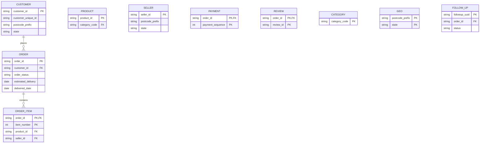

# olist-abap-monitor

## Project Overview
An ABAP Cloud portfolio based on the Brazilian Olist e-commerce dataset.

The objective is to design an implement a backend application using modern SAP development technologies,
including ABAP SQL, Core Data Service (CDS), object-oriented ABAP, and the RESTful Application Programming Model (RAP).

## Business Objectives

The application will answer the following questions:

1. Which orders were delivered later than expected?
2. Which sellers are associated with delayed orders?
3. How do customer review scores vary with delivery performance?
4. What are product, freight, and payment totals per order?

## Technology Stack
- SAP ABAP Cloud
- ABAP SQL, Dictionary
- ABAP Core Data Services (CDS)
- RESTful Application Programming Model (RAP)
- SAP Fiori Elements
- OData V4
- ABAP Unit and ATC
- abapGit and Github

## Dataset
The project uses the Brazilian Olist e-commerce dataset.
Source: https://www.kaggle.com/datasets/olistbr/brazilian-ecommerce

Original Olist data is not committed to this repository.

## Project Status
Currently under development.

# Olist Database - ERD (Entity Relationship Diagram)

This diagram documents the planned data model for the Olist Fulfillment Monitor.

